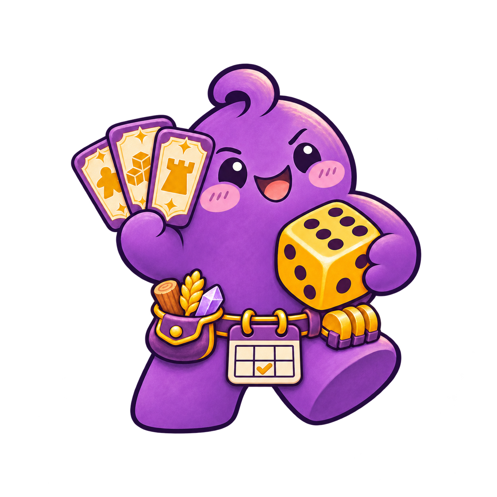

# Board Game Organizer

<p align="center">
  
</p>

[](https://github.com/BGOrganizer/board-game-organizer/actions/workflows/pr-ci.yml "CI")
[](https://codecov.io/gh/BGOrganizer/board-game-organizer)

Organize board-game nights across the [Web app](https://app.board-game-organizer.com), native mobile
and MCP clients. The [public site](https://board-game-organizer.com) explains the project and links to
the Web app and Android releases.

[Get started](#get-started) | [Commands](#commands) | [Project structure](#project-structure) | [Documentation](#documentation)

## What you can do

- Create private Groups for regular gatherings or public Groups for associations and game libraries.
  Approved public Groups can host members-only or public Events.
- Plan standalone or Group Events, propose dates, verified venues and games, and collect votes.
  Players can review who voted when they have access to the relevant ballots.
- Arrange seats and waiting lists manually or with assistance; prioritize player count or BGG Best.
  Event confirmation remains an explicit manager action.
- Invite friends or share a single-use Table link for a private Group Event. Managers of standalone
  and private Group Events can seat guests and enter their votes when needed.
- Record whole-event results, see rating changes, and browse global or group OpenSkill rankings by game.
- Connect with friends, search users and discover permission-gated device contacts on mobile.
- Link a BoardGameGeek account, sync owned games and browse a MongoDB-backed catalog with
  covers, durations, difficulty and player-count recommendations. Compare visible collections
  when choosing what to play.
- Receive in-app updates and optional push notifications, with English/Italian and light/dark UI.
- Use BGO in compatible MCP chat clients. Browse interactive HeroUI cards for groups, events and
  tables, open their detail tabs and use the same account permissions as the Web app.

Main navigation is **History / Events / Groups / Community / Contacts**:

- **History:** completed, actually confirmed tables where you played, demonstrated, or currently have management authority.
- **Events:** Scheduled contains your active registrations, invitations, demonstrations and managed Events.
  Available contains other enrollable planning Events: private Events require Group membership; approved public Events do not.
  Terminated contains completed Events where you played, demonstrated, or still have management authority.
  These lists retain text filtering and infinite scrolling without state-filter chips.
- **Groups:** Private and Public lists show your groups; use Search to discover approved public groups.
- **Community:** Activities from your network, global Rankings, and the Marketplace placeholder.
- **Contacts:** Connections, Requests, Contacts and Search. Device contacts and remote search have separate lists;
  web shows registered contacts from the synchronized snapshot.

> [!NOTE]
> The [Groups / Events / Tables contract](docs/groups-events-tables.md) defines domain behavior.
> Assess release readiness using current CI and runtime evidence, following the
> [verification requirements](docs/verification-and-acceptance.md).

## Get started

### Requirements

- **Node.js 26** and **Bun 1.4.4**, matching CI and `packageManager`.
- **Docker with Compose** for the local MongoDB replica set and integration tests.
- Clerk development keys, public MapTiler keys for each client and a server MapTiler key for address verification.
- A BGG rankings CSV at `scripts/mongodb/data/boardgames_ranks.csv`; see [catalog setup](scripts/mongodb/README.md).
- For mobile: an Android/iOS development build and the matching native toolchain. Expo Go and Expo web are unsupported.

### Install and configure

From the repository root:

```sh
bun install --frozen-lockfile
```

Copy each template to the corresponding private file, then fill its placeholders:

| App | Template | Local configuration |
| --- | --- | --- |
| API | `apps/api/.env.example` | `apps/api/.env.local` |
| Web | `apps/web/.env.example` | `apps/web/.env.local` |
| Mobile | `apps/mobile/.env.example` | `apps/mobile/.env` |

Use the same Clerk development instance across the API and clients. Configure Clerk user webhooks
for profile/contact discovery; existing users can be mirrored with `bun run --filter api backfill:users`.
Sentry and push credentials are optional; the notification inbox works without push configuration.
BGG linking and synchronization need the API's `BGG_TOKEN`.

For a physical device, set `EXPO_PUBLIC_API_URL` to your computer's reachable LAN address.
Keep populated configuration files private; `NEXT_PUBLIC_*` and `EXPO_PUBLIC_*` values are public client configuration.

### Start the database

With the CSV in place and Docker running:

```sh
docker compose up -d --wait --wait-timeout 600
bun run --filter api migrate
```

Compose initializes MongoDB 7 as replica set `rs0` and imports the CSV before reporting healthy.
To update the catalog later, replace the CSV and recreate the MongoDB container; follow the
[catalog update procedure](scripts/mongodb/README.md#update-the-local-catalog).
The API template contains the local connection URI. `docker compose logs -f mongodb` shows import progress.
Migrations create indexes and remove the legacy `relationships` collection; run them against your intended local database.

### Run the apps

Run each command in its own terminal:

| App | Command | Local endpoint |
| --- | --- | --- |
| API | `bun run --filter api dev` | <http://localhost:4000> |
| Web | `bun run --filter web dev` | <http://localhost:3000> |
| Site | `bun run --filter site dev` | <http://localhost:3001> |
| Mobile | `bun run --filter mobile dev` | Expo development-client server |

`bun run dev` starts all workspace development tasks through Turborepo.
For a first local Android build use `bun run --filter mobile android`; on macOS with Xcode use
`bun run --filter mobile ios`. Starting Metro alone does not build the native app.

## Commands

Run from the repository root. Bun manages dependencies and scripts; application tools retain Node.js.

| Task | Command |
| --- | --- |
| Lint and formatting checks | `bun run lint` |
| Type checking | `bun run typecheck` |
| App unit tests | `bun run --filter web test` (or `api`, `mobile`) |
| Shared logic tests | `bun run --filter @board-game-organizer/shared test` |
| Schema tests | `bun run --filter @board-game-organizer/schemas test` |
| Unit coverage | `bun run --filter web test:coverage` (also API, Mobile, MCP, Site, Shared and Schemas) |
| React rendering benchmarks | `bun run perf:web` / `bun run perf:mobile` |
| MongoDB integration tests | `bun run --filter api test:integration` |
| One web test file | `bun run --filter web test src/components/events/__tests__/useTableSeatOrder.test.tsx` |
| Web E2E | `bun run --filter web test:e2e` |
| MCP tests | `bun run --filter @board-game-organizer/mcp test:coverage` |
| MCP widget browser tests | Build the widget, then `bun run --filter @board-game-organizer/mcp test:e2e` |
| Site tests | `bun run --filter site test:coverage` / `bun run --filter site test:e2e` |
| Workspace builds | `bun run build` |
| Extract / compile translations | `bun run i18n:extract` / `bun run i18n:compile` |
| Regenerate / verify artwork | `node scripts/branding/export.mjs` / `node scripts/branding/export.mjs --check` |

Use the workspace scripts above for Vitest. `bun run build` builds API, Web, Site and the MCP widget.
Integration tests start a Testcontainers replica set and need Docker. Web E2E requires running apps or an
explicit `PLAYWRIGHT_BASE_URL`, the matching API/Clerk configuration and provisioned test users.
Native UI acceptance uses the retained [Maestro flows](apps/mobile/.maestro). Mobile Vitest covers
logic and components. The merge gate requires at least 98% of lines, statements, functions and
branches in each app and runtime package. The [render benchmarks](docs/render-performance.md)
use Reassure and Testing Library to measure React commits on Web and Mobile. Branch, Preview and
Main CI publish the paired baseline and candidate reports.
See [delivery details](docs/development.md#delivery) for CI policy and acceptance limits.
The required `PR ready` check demands at least 98% line, branch, function and statement coverage
in each application/runtime coverage suite.

## Project structure

| Path | Responsibility |
| --- | --- |
| `apps/web` | Authenticated application with Next.js 16, React 19, HeroUI 3 and Tailwind CSS 4 |
| `apps/site` | Public informational site, APK download and application links |
| `apps/mobile` | Expo SDK 57, React Native 0.86, HeroUI Native and Uniwind |
| `apps/api` | Next.js route handlers, Clerk, MongoDB and zod |
| `apps/mcp` | MCP tool transport and HeroUI views embedded in compatible host clients |
| `packages/shared` / `schemas` | Domain logic, Query hooks, models and DTOs |
| `packages/query` / `store` | TanStack Query server state / Zustand UI and unsaved drafts |
| `packages/biome-config` / `typescript-config` | Shared tooling configuration |
| `messages` | Shared Lingui English/Italian source and compiled catalogs |
| `docs` | Domain specifications, setup details and verification evidence |
| `.github` | CI/CD workflows, actions and supporting scripts |

Web and mobile own their UI; pure behavior is shared. Maps use MapTiler and native MapLibre.
Read [AGENTS.md](AGENTS.md) before changing code.

## Client responsiveness defaults

Clients retain cached data while refreshing and use bounded lists and optimistic mutation feedback.
Web pages scroll as documents beneath the persistent main navigation. Secondary-page Back controls
and contextual actions share a page toolbar; game collections and pickers retain windowed rendering
without their own scrolling viewport. Popups and selects keep bounded internal scrolling.
Native Query data persists in an account/API-scoped encrypted cache; restoration does not grant authentication
or permission. Native cache retention, build requirements and implementation rules live in
[the development reference](docs/development.md#native-cache-and-builds) and
[responsiveness defaults](docs/development.md#client-responsiveness-defaults).

## Documentation

- [Groups, Events and Tables](docs/groups-events-tables.md) | current behavior and permissions.
- [Profiles and BGG collections](docs/profiles.md) and [Community](docs/community.md).
- [Notifications](docs/notifications.md) | events, icons, localized copy and bell destinations.
- [Development reference](docs/development.md) | cache, responsiveness, BGG enrichment and delivery.
- [Public Site](apps/site/README.md) | local preview, localization and deployment.
- [MCP Apps](docs/mcp-apps.md) | OAuth, BGO tools, interactive cards and fullscreen navigation.
- [Operations](docs/deployment-operations.md) | environment isolation, deployment gates and [Vercel and Netlify deployment with CI fallback](docs/deployment-operations.md#vercel-preflight-and-netlify-fallback).
- [Hosting project setup](docs/deployment-operations.md#scaffold-hosting-projects) | create missing Vercel or Netlify projects using the manual GitHub workflow.
- [Production DNS](docs/deployment-operations.md#production-dns-switch) | verify canonical origins and route API, Web and Site through Cloudflare.
- [Verification requirements](docs/verification-and-acceptance.md) | required checks and evidence limits.
- [Mascot and app artwork](docs/branding.md) | source assets and platform exports.

## License

Copyright (c) 2026 Alessandro Mancini and the respective contributors.

Board Game Organizer is licensed under the **GNU Affero General Public License v3.0 only**
(`AGPL-3.0-only`). You may use, modify and redistribute the covered software, including commercially,
under the license terms. Distributing covered versions requires providing the corresponding source;
modified versions used over a network must offer their corresponding source to the users interacting
with them. See [LICENSE](LICENSE) for the full terms.

Third-party dependencies and separately licensed materials retain their own licenses and attribution.
