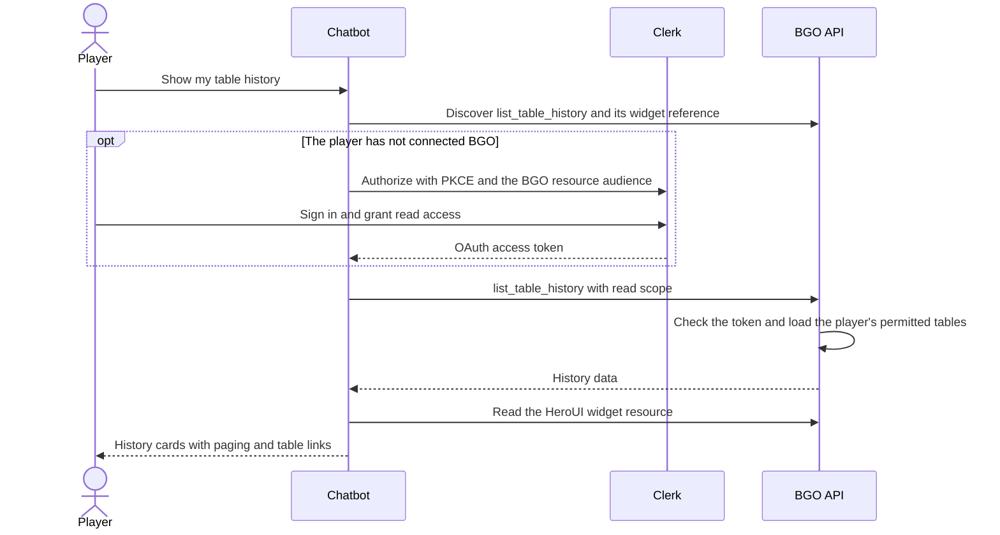
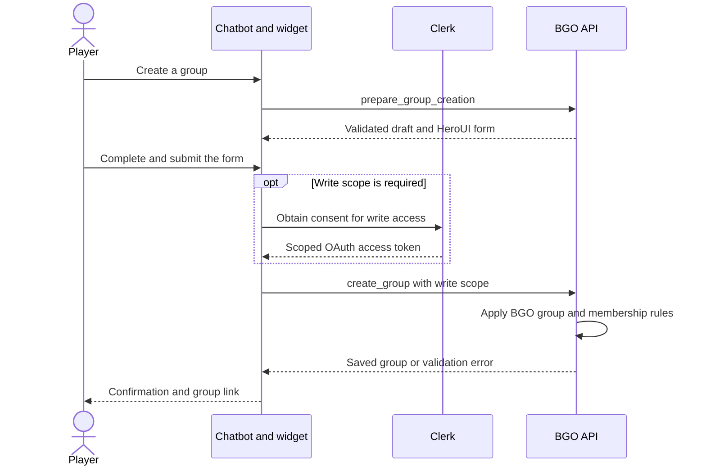

# Board Game Organizer MCP Apps

The [`apps/mcp`](../apps/mcp) workspace implements a remote MCP server and a HeroUI widget for hosts
that support MCP Apps, including ChatGPT. The existing API deployment serves the server at `/mcp`.
The API build compiles and includes the widget. A small public gateway can connect MCP clients to
a protected Development API without exposing the rest of the Preview.

## Capabilities

The [operation registry](../apps/api/src/app/lib/mcp/operations.ts) exposes the current user-facing
API methods for groups, events, tables, registrations, votes and proposals, results and ratings,
profiles, BoardGameGeek, locations, notifications, social relationships and invites. Provider
webhooks, health checks, background workers, infrastructure administration and retired routes stay
outside the MCP interface. Native contact sync, push subscriptions and logo upload chunks are
app-only tools because their inputs contain device data or file bytes. Contact sync and push
registration require the inputs from a compatible client device.

The widget reuses BGO's Web card and popover views for events, tables, groups and history. It also
reuses the responsive leaderboard, finished-table OpenSkill results, BGG game rows and metadata,
location rows, the invite link card, notification cards, profile summaries and the people and
activity rows. The group creation form uses the existing BGO fields and
pickers with verified venues and staged logo uploads. Tools return structured information to the
chatbot, including operations that use a compact action receipt instead of a domain view. MCP clients without
widget support can still use the tools and their structured responses.

## Hosting and authentication

1. Set `MCP_RESOURCE_URL` to the exact public endpoint for the environment, for example
   `https://api.board-game-organizer.com/mcp`. Set `MCP_CLERK_ISSUER` to the matching Clerk instance's
   HTTPS Frontend API origin, without a trailing slash. Sync the settings through Infisical as
   described in the [operational gates](organizations-events-operations.md). Both settings are
   required to enable MCP. Development and Production use their own Clerk instances and API data.
2. In the matching Clerk instance, register the full URL under MCP servers and verify Include
   Audience is on. Configure the OAuth application for the MCP client to issue JWT access tokens
   with that resource audience. Configure the client with its host's redirect URIs, OAuth 2.1 authorization
   code flow and PKCE. For ChatGPT onboarding, configure Clerk's support for the client's OAuth
   metadata document when supported by the target instance. Use the exact `/mcp` resource URL and
   configure the custom scopes `bgo:read` and `bgo:write` in the OAuth settings. Advertise both
   scopes and allow them for the intended client. A client that omits the scope parameter takes
   the configured default scopes. See the
   [Clerk MCP guide](https://clerk.com/docs/nextjs/guides/ai/mcp/build-mcp-server) and
   [OpenAI OAuth guide](https://developers.openai.com/plugins/build/auth).
3. Set `VITE_BGO_WEB_URL` for builds whose widget links should open a Web deployment other than
   `https://app.board-game-organizer.com`. Use the Web origin for the same environment as the API.
4. Connect the MCP host to `MCP_RESOURCE_URL`. In Development, run the sign-in, table history and
   group creation flows with a test account. Check that another account cannot read a private group
   or write to a table it does not manage. Check that calls without the write scope cannot mutate data.

The public protected-resource metadata is at `/.well-known/oauth-protected-resource/mcp`.
The server verifies Clerk OAuth access tokens, including the issuer, audience, expiration and
scopes. Ordinary BGO session tokens remain confined to the existing REST clients. The widget uses
host-mediated tool calls. It never receives or forwards OAuth credentials. The existing API handlers
continue to enforce group roles, private data visibility, consent and validation for every tool call.

## Try the tools in Codex

Use the public gateway URL with `/mcp` appended. Register that exact URL in Clerk and set the
protected API deployment's `MCP_RESOURCE_URL` to it. `BGO_DEV_MCP_URL` is a local shell variable
holding the same value for the commands below. If Codex runs on the same machine as a locally
configured API, it can also connect directly over loopback with matching OAuth configuration.

```bash
codex mcp add bgo-dev --url "$BGO_DEV_MCP_URL" --oauth-resource "$BGO_DEV_MCP_URL"
codex mcp login bgo-dev --scopes bgo:read,bgo:write
codex mcp list
codex
```

Use `/mcp` to check the server in the new session. Start with “Show my scheduled BGO events” or
“Show my table history”. Before testing writes, use a Development account and a test group or
event. Configure `default_tools_approval_mode = "writes"` for `mcp_servers.bgo-dev` in your private
Codex configuration if you want explicit Codex approval for every write. On a headless Raspberry,
use `--no-browser` on `codex mcp login`, open the displayed authorization URL on your computer,
and paste the full callback only into the terminal running the login.
[Codex MCP setup](https://learn.chatgpt.com/docs/extend/mcp?surface=cli)

To inspect the interactive cards within a chat, open **ChatGPT Plugins → + → Add custom MCP server**,
enter the same Development endpoint, and configure OAuth. Install the plugin, select it via `@`
in a new conversation, and sign in with a Development account when prompted. Account and workspace
permissions govern access to custom servers. Codex can also run the Playwright widget tests using
the local browser and the emulated MCP host. Those tests exercise UI interaction separately from
the Clerk login and production data.
[Connect and test your plugin](https://developers.openai.com/plugins/deploy/connect-chatgpt#add-the-mcp-server)

## Gateway for protected Development previews

Build with `bun apps/mcp/gateway-build.mts <project-directory>/.vercel/output` and deploy that
directory to a dedicated Vercel project with `vercel deploy --prebuilt --prod`. Set
`BGO_MCP_UPSTREAM_URL` to the verified, stable Development API alias for the selected PR. Add
`VERCEL_PROTECTION_BYPASS` to the gateway as a server-side secret. Keep the bypass out of the public
MCP URL and OAuth metadata. The gateway accepts only `POST /mcp` and `GET` or `OPTIONS` on
`/.well-known/oauth-protected-resource/mcp`. API deployment protection and Clerk authorization still
apply. Run-scoped CI databases do not expose the MCP resource.

## Example flows

### Read my table history



### Create a group



If the host loses a creation receipt, the widget links to the player's groups to check the result
before a new submission.

## Local checks

```bash
bun run --filter @board-game-organizer/mcp test:coverage
bun run --filter api test src/app/lib/mcp
bun run --filter api build
bun run --filter @board-game-organizer/mcp test:e2e
```

The suites cover JSON-RPC requests over Streamable HTTP, OAuth JWT verification using a local RSA
key, independent request identities, route coverage and the widget with React Testing Library and
HeroUI. The Playwright suite renders the packaged widget in Chromium with an emulated MCP host and a
restricted iframe. Run it after the build with Playwright Chromium installed. OAuth linking in
ChatGPT and authenticated
end-to-end acceptance depend on the live host and configured Development OAuth client.
